

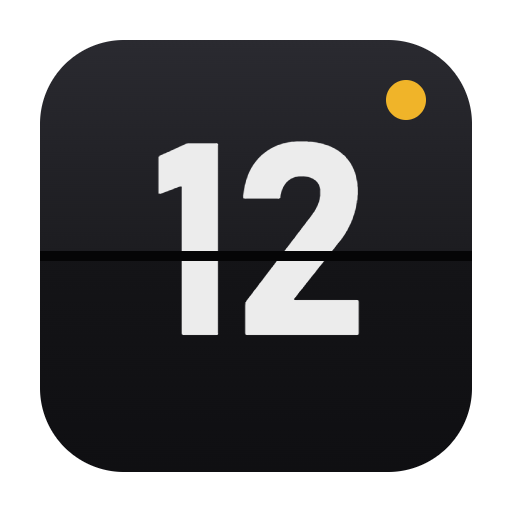

# FlipClock

**Jam flip clock untuk Windows dengan tanggal, cuaca, jadwal sholat, Jam Masjid, screensaver, dan 15 tema.**

 

&nbsp;

  

<a href="https://github.com/Najib97/FlipClock-Download/releases">Semua versi & catatan rilis</a>

  

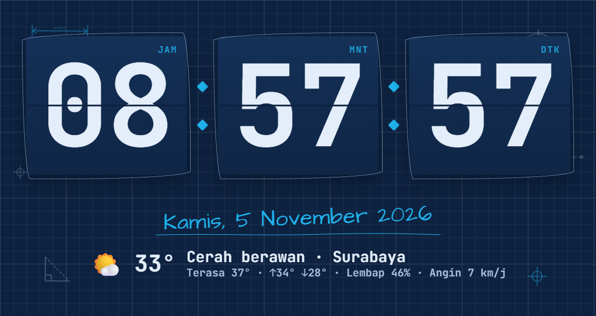

---

## ⬇ Download

| | File | Ukuran | Cocok untuk |
|:-:|---|:-:|---|
| 💿 | **[FlipClock-Setup.exe](https://github.com/Najib97/FlipClock-Download/releases/latest/download/FlipClock-Setup.exe)** | ±91 MB | **Disarankan.** Dipasang di komputer, ada shortcut Desktop & Start Menu, **update otomatis**, dan screensaver Windows. |
| 🎒 | **[FlipClock-Portable.exe](https://github.com/Najib97/FlipClock-Download/releases/latest/download/FlipClock-Portable.exe)** | ±91 MB | Langsung jalan tanpa instalasi, cocok dibawa di flashdisk atau untuk PC kantor. |

**Kebutuhan:** Windows 10 atau 11 (64-bit). Internet hanya diperlukan untuk cuaca dan cek update. Jam, jadwal sholat, dan hari libur tetap jalan saat offline.

### Cara pasang

1. Unduh **FlipClock-Setup.exe**, lalu jalankan.
2. Kalau muncul **"Windows protected your PC"**, klik **More info → Run anyway**. Peringatan ini muncul karena aplikasi belum ditandatangani sertifikat berbayar, bukan karena berbahaya.
3. Ikuti langkah installer. Kalau FlipClock sudah terpasang, Anda bisa memilih **Perbaiki/perbarui** atau **Hapus**.

FlipClock memeriksa versi baru secara otomatis. Kalau ada, tombol **⬆ Update** muncul di toolbar.

---

## ✨ Fitur

| | Gratis | Pro |
|---|:---:|:---:|
| Jam flip 3D, tanggal Indonesia, cuaca, maximize, fullscreen di monitor mana saja | ✅ | ✅ |
| Waktu sholat berikutnya & hari libur nasional (dihitung offline) | ✅ | ✅ |
| 6 tema: Klasik, Kertas, Retro, Neon, Sakura, Doodle Blueprint | ✅ | ✅ |
| Screensaver Windows, autostart, mode malam, anti burn-in, widget mini | ✅ | ✅ |
| **Jam Masjid**: jadwal 7 waktu, adzan, hitung mundur iqamah, layar gelap saat sholat, mode Jum'at | | ✅ |
| **Remote dari HP**: scan QR, atur tema/tampilan/running text/timer, kirim pesan ke layar | | ✅ |
| **Multi-layar**: tampilan berbeda di tiap monitor | | ✅ |
| Jam Dunia, Cuaca lengkap (per jam, 7 hari, kualitas udara, peringatan hujan) | | ✅ |
| Timer, Stopwatch, Pomodoro, Alarm | | ✅ |
| Hitung mundur acara & Google Calendar | | ✅ |
| Logo usaha, running text, jadwal layar, kunci PIN | | ✅ |
| **9 tema Pro** (3 Doodle baru, Emas, Hijau Masjid, Kayu, Terminal, Aurora) + editor tema | | ✅ |
| Suara flip & bel tiap jam | | ✅ |

### 💛 Dapatkan Pro, bayar seikhlasnya

Buka FlipClock → ⚙ **Pengaturan → Lisensi → 🛒 Beli Pro**:

1. Isi nominal **seikhlasnya** (minimal Rp1.000). QRIS dengan nominal itu langsung muncul.
2. Scan dan bayar dari m-banking atau e-wallet apa saja (GoPay, OVO, DANA, ShopeePay, BCA, dan lainnya).
3. Klik **Kirim bukti via WhatsApp**, lalu lampirkan screenshot bukti bayar.
4. Kunci lisensi dikirim balik lewat WhatsApp. Tempel di kolom kunci, lalu klik **Aktifkan Pro**.

---

## 🖼 Tampilan

| Jam Masjid · Hijau Masjid | Jam Dunia · Emas Mewah |
|---|---|
| 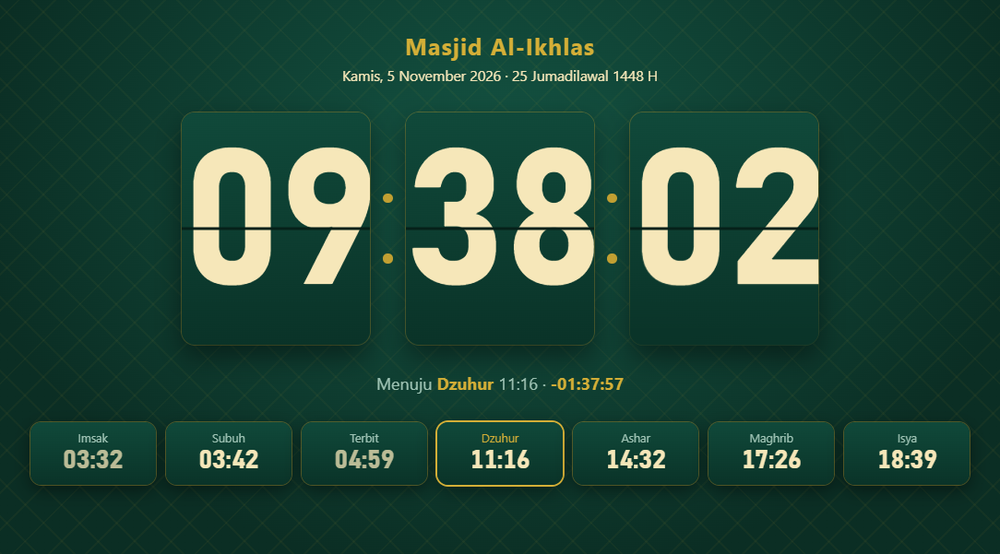 | 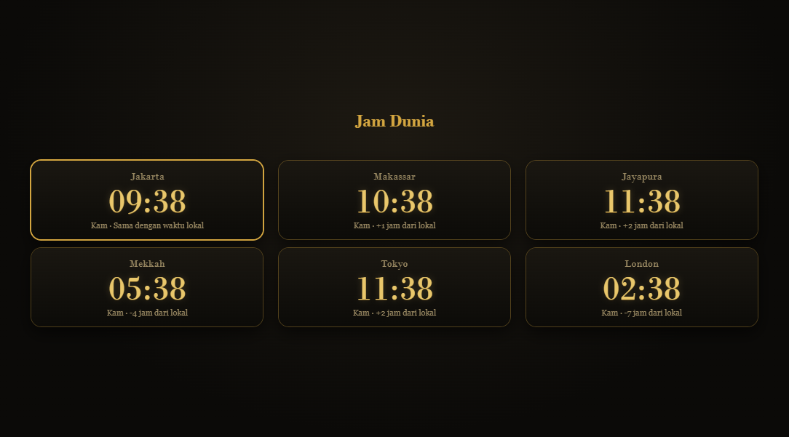 |
| **Cuaca lengkap** | **Timer · Doodle Papan Kapur** |
| 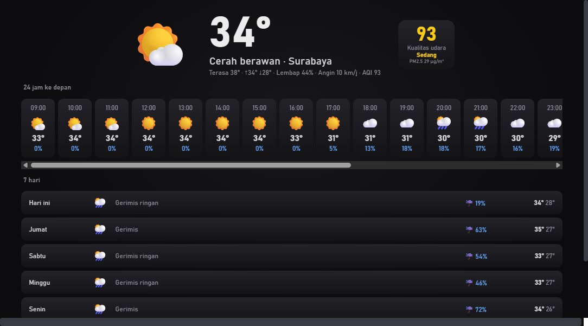 | 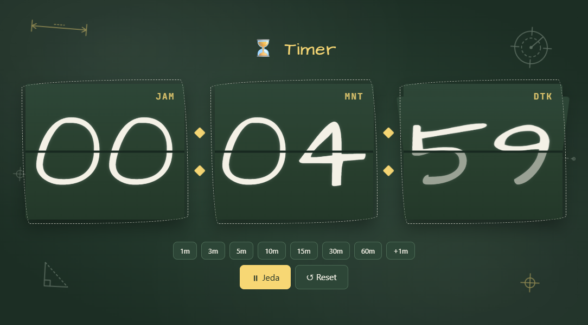 |

<b>Lihat semua 15 tema & running text</b>

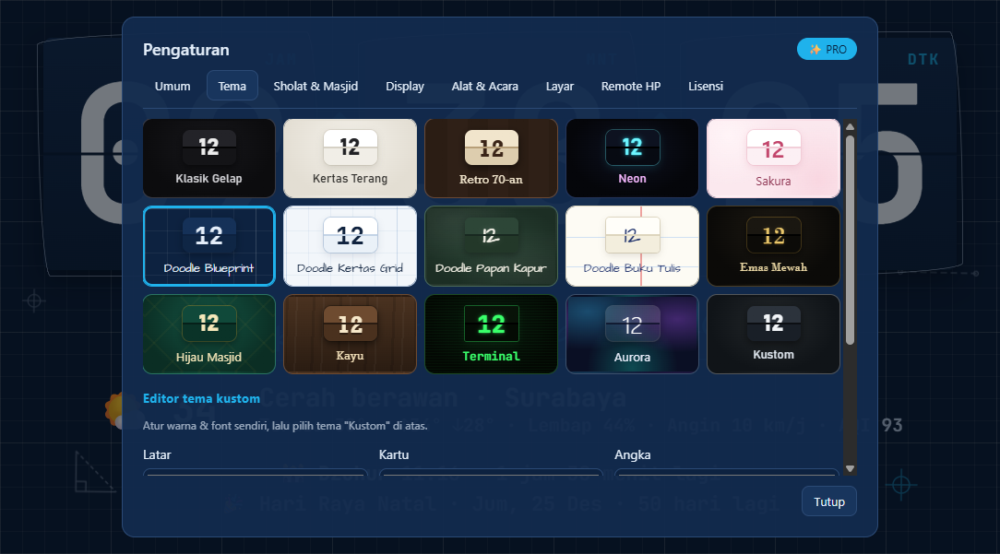

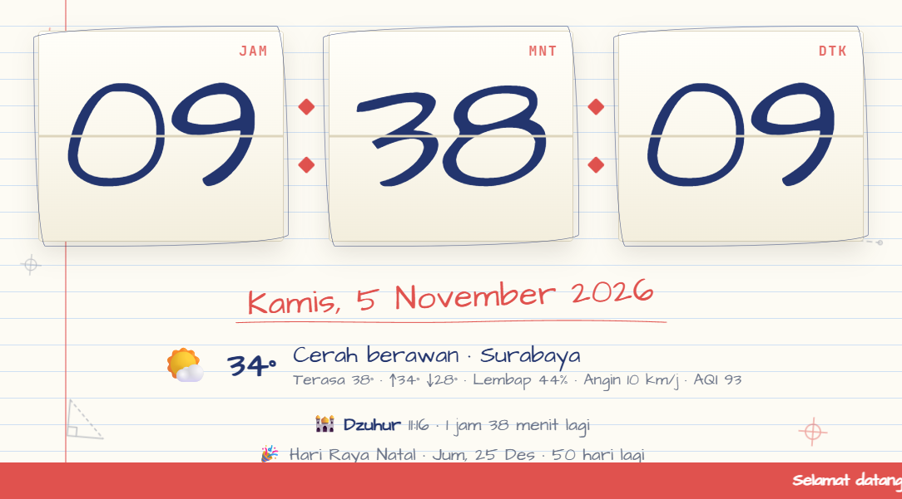

| Klasik Gelap | Kertas Terang | Retro 70-an |
|---|---|---|
| 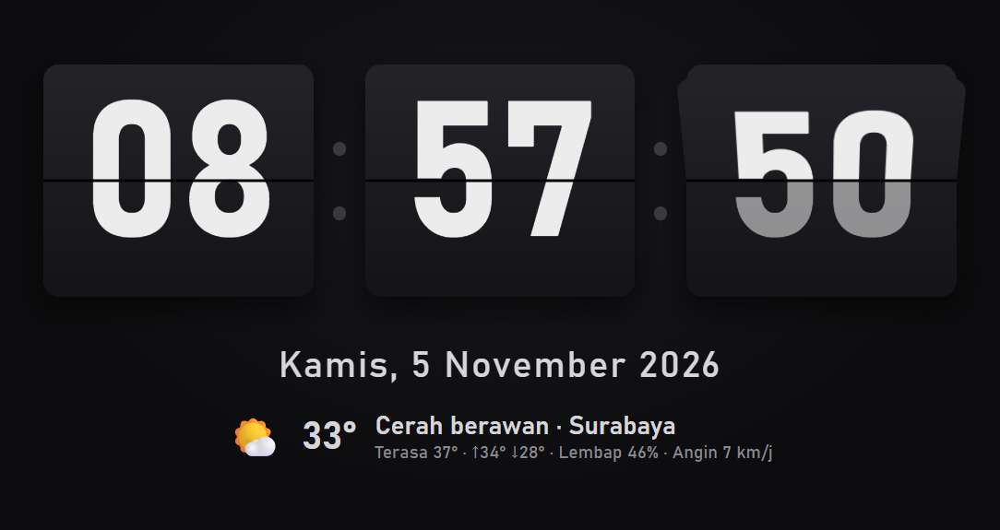 | 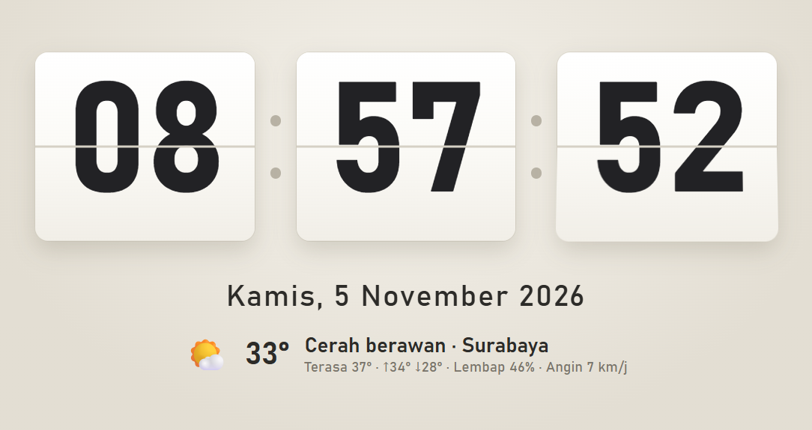 | 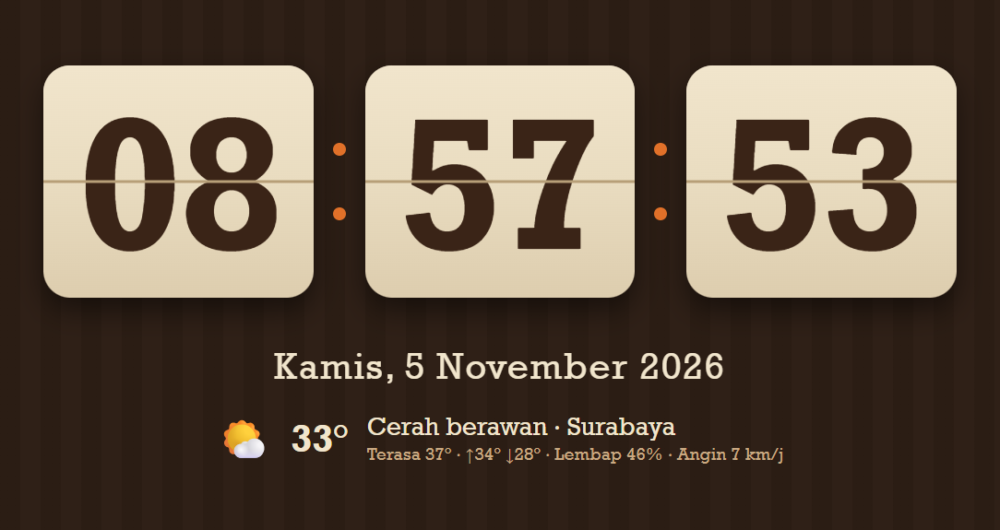 |
| **Neon** | **Sakura** | **Doodle Blueprint** |
| 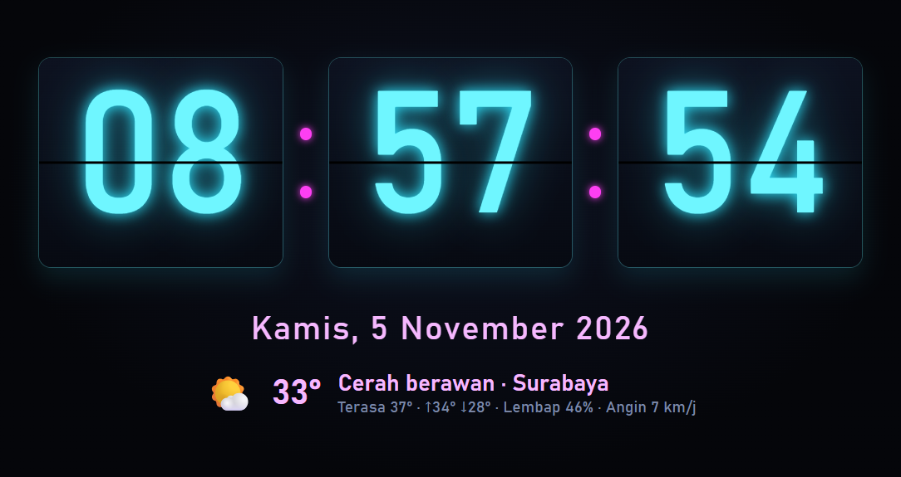 | 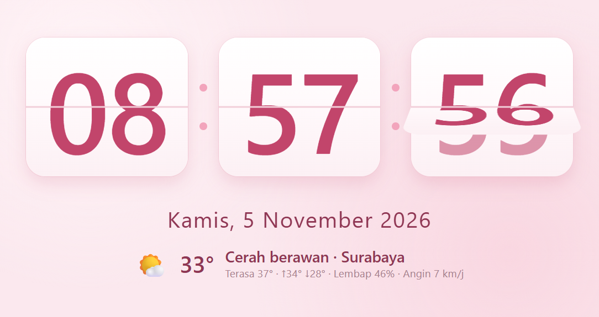 |  |

---

## 📖 Panduan singkat

<b>Fullscreen di monitor tertentu</b>

Gerakkan mouse untuk memunculkan toolbar, lalu pilih **⛶ Fullscreen ▾** dan pilih monitornya. Bisa juga dengan tombol `1`–`9` (monitor ke-N). Tekan `Esc` untuk keluar.

Untuk tampilan berbeda di tiap monitor (Pro), buka ⚙ **Pengaturan → Layar → Multi-layar**.

<b>Memasang screensaver</b>

1. Pasang FlipClock dengan **FlipClock-Setup.exe**.
2. Buka ⚙ **Pengaturan → Layar → Screensaver Windows**.
3. Isi "Mulai setelah diam (menit)", lalu klik **Pasang sebagai screensaver**.

Di daftar screensaver Windows, namanya **"FlipClock Pro"**. Screensaver memakai tema dan tampilan yang sama dengan aplikasi, dan tampil di semua monitor.

Kalau FlipClock dipakai di TV pajangan yang tidak boleh mati, centang **Mode pajangan**. Konsekuensinya, screensaver tidak muncul selama FlipClock fullscreen.

<b>Jadwal sholat & Jam Masjid</b>

- Dihitung **offline** dengan parameter Kemenag RI: Subuh 20°, Isya 18°, Ashar Syafi'i, Imsak = Subuh − 10 menit, plus ihtiyat.
- Lokasi mengikuti kota yang diisi, atau terdeteksi otomatis.
- Ada koreksi menit per waktu sholat, supaya sama persis dengan jadwal masjid setempat.
- Tanggal Hijriah memakai kalender Umm al-Qura, dengan koreksi ±hari.
- Mode Jam Masjid (Pro) menampilkan layar adzan, hitung mundur iqamah, dan layar gelap saat sholat. Audio adzan bisa diganti dengan MP3 sendiri.

<b>Remote dari HP (Pro)</b>

1. Buka ⚙ **Pengaturan → Remote HP**, lalu aktifkan.
2. Scan QR dengan kamera HP. HP dan komputer harus satu Wi-Fi.
3. Dari HP Anda bisa mengganti tema/tampilan, mengirim pesan layar penuh, mengatur running text, timer, stopwatch, Pomodoro, layar hitam, dan mode malam.

<b>Pintasan keyboard</b>

| Tombol | Fungsi |
|---|---|
| `F11` | Fullscreen di layar saat ini / keluar |
| `1` – `9` | Fullscreen di monitor ke-N |
| `T` | Ganti tema |
| `V` | Ganti tampilan (Pro) |
| `Spasi` | Mulai/jeda timer, stopwatch, Pomodoro |
| `Esc` | Keluar fullscreen, menutup menu, pengaturan, atau pesan |
| Double-click | Maximize / Restore |

<b>Ringan untuk menyala 24 jam</b>

- RAM sekitar **90 MB** dengan 2 proses, dan CPU sekitar 2% saat animasi berjalan.
- Saat jendela diminimize, semua kerja visual berhenti. Alarm dan adzan tetap jalan.
- Mengikuti pengaturan "kurangi animasi" di Windows.

---

## 💬 Bantuan & saran

Ada pertanyaan, masalah, atau ide fitur? Buka tab **[Issues](https://github.com/Najib97/FlipClock-Download/issues)**, atau hubungi lewat WhatsApp **[0896-8150-3428](https://wa.me/6289681503428)**.

Data cuaca dari [Open-Meteo](https://open-meteo.com/). Dibuat dengan [Electron](https://www.electronjs.org/).

© 2026 Berkah Tech · FlipClock

